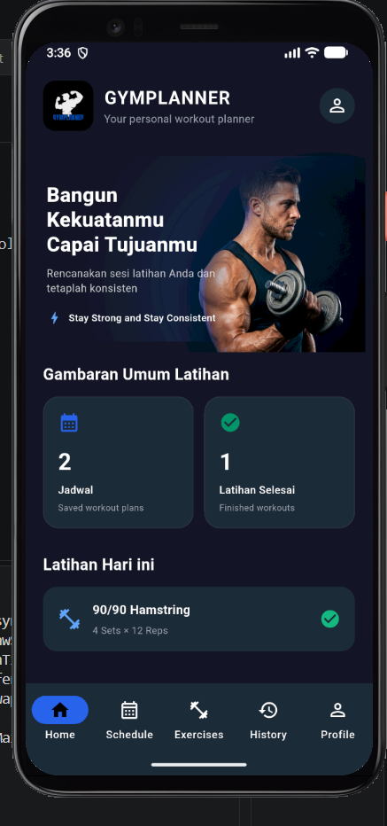
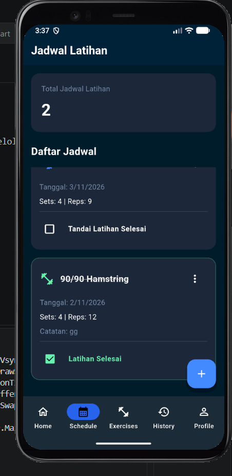
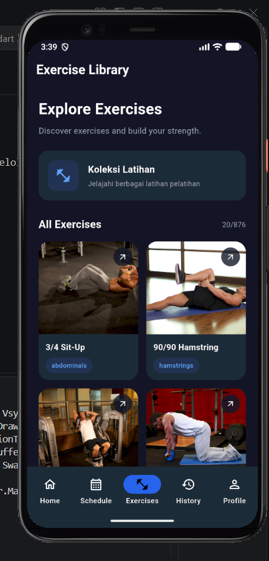
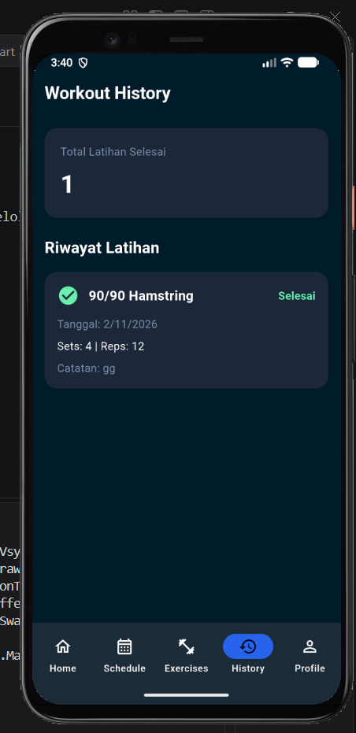
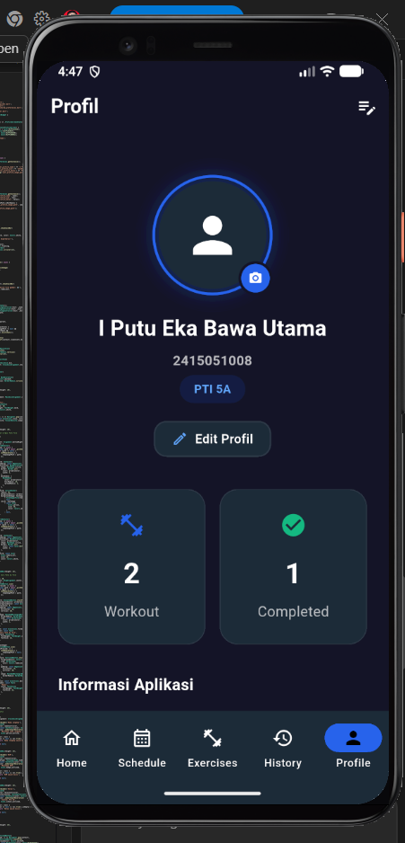

# GYMPLANNER

## Deskripsi

GYMPLANNER merupakan aplikasi mobile berbasis Flutter yang dirancang untuk membantu pengguna dalam mengelola dan merencanakan aktivitas workout. Aplikasi ini menyediakan fitur pengelolaan latihan, penjadwalan workout, serta pencatatan riwayat latihan untuk membantu pengguna memantau aktivitas kebugaran.

## Identitas Pengembang

- **Nama:** I Putu Eka Bawa Utama
- **NIM:** 2415051008
- **Kelas:** PTI 5A

## Fitur Utama

- **Home Dashboard** — Menampilkan informasi dan ringkasan aktivitas workout.
- **Exercise Management** — Menampilkan daftar latihan beserta informasi detail latihan.
- **Workout Schedule** — Mengelola jadwal latihan, termasuk menambah, mengedit, dan menghapus jadwal.
- **Workout History** — Menampilkan riwayat aktivitas workout.
- **Workout Completion** — Menandai latihan yang telah diselesaikan.
- **Profile** — Menampilkan profil dan statistik workout.
- **Responsive Design** — Menyesuaikan tampilan aplikasi pada berbagai ukuran layar.
- **Error Handling** — Menangani kesalahan pada proses aplikasi, API, dan database.

## Tech Stack

- **Framework:** Flutter
- **Programming Language:** Dart
- **State Management:** Provider
- **Backend & Database:** Supabase (PostgreSQL)
- **REST API:** [Tuliskan nama API dan endpoint yang benar-benar digunakan]
- **Development Tools:** Visual Studio Code

## REST API

GYMPLANNER menggunakan REST API untuk memperoleh data latihan (exercise).

- **API:** [Nama REST API]
- **Endpoint:** [URL endpoint yang digunakan]
- **HTTP Method:** GET
- **Data Format:** JSON

Data response JSON dikonversi menjadi Dart Model menggunakan `ExerciseModel.fromJson()` sebelum ditampilkan pada aplikasi.

## Backend & Database

GYMPLANNER menggunakan Supabase sebagai backend service dengan PostgreSQL sebagai database. Database digunakan untuk menyimpan dan mengelola jadwal latihan pengguna.

Tabel utama yang digunakan adalah workout_schedules, dengan struktur field sebagai berikut:

id — UUID sebagai Primary Key.

exercise_id — TEXT untuk menyimpan ID latihan.

exercise_name — TEXT untuk menyimpan nama latihan.

workout_date — DATE untuk menyimpan tanggal latihan.

sets — INT4 untuk menyimpan jumlah set.

reps — INT4 untuk menyimpan jumlah repetisi.

## Struktur Arsitektur Aplikasi

```text
lib/
├── models/
│   └── exercise_model.dart
├── providers/
├── repositories/
├── screens/
├── services/
├── widgets/
└── main.dart
```

Aplikasi menerapkan pemisahan tanggung jawab antara UI, state management, model, dan layanan pengelolaan data.

## Screenshot Aplikasi

### Home Dashboard


### Workout Schedule


### Exercise


### Workout History


### Profil


## Cara Menjalankan Project

### Prasyarat

- Flutter SDK
- Dart SDK
- Visual Studio Code atau IDE lainnya
- Android Emulator atau perangkat Android
- Konfigurasi Supabase

### Instalasi

1. Clone repository:

```bash
git clone https://github.com/ekabawa/GymPlannerAPK.git
```

2. Masuk ke direktori project:

```bash
cd flutter_gymplanner
```

3. Install dependencies:

```bash
flutter pub get
```

4. Konfigurasikan Supabase menggunakan credential client yang sesuai. Jangan menggunakan `service_role` key pada aplikasi Flutter.

5. Jalankan aplikasi:

```bash
flutter run
```

## Repository

GitHub: https://github.com/ekabawa/GymPlannerAPK

## Pengembang

**I Putu Eka Bawa Utama**

Project ini dikembangkan sebagai bagian dari mata kuliah Pemrograman Mobile.
